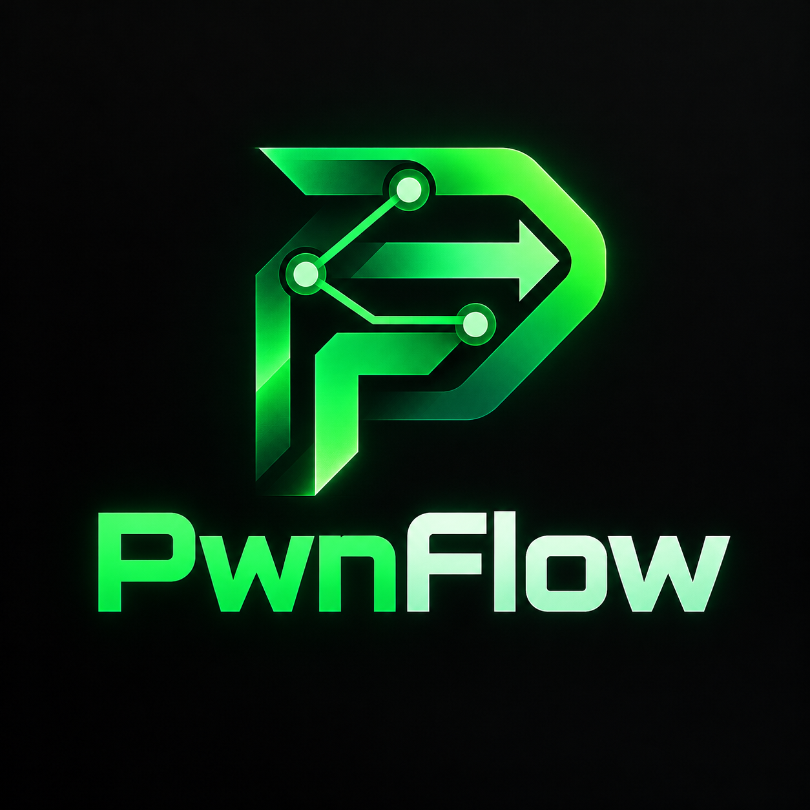

<p align="center">
  
</p>

<p align="center"><strong>Active Directory Enumeration &amp; Security Evidence — From Discovery to Findings.</strong></p>

## What is PwnFlow?

PwnFlow is a Go/Bubble Tea terminal application for authorized Active Directory enumeration, evidence collection, and Findings review. It discovers and organizes source-backed evidence for operator decisions; it does not automatically exploit vulnerabilities.

Original assessment artifacts remain available for review, while Findings provide structured, provenance-aware summaries and navigation.

## Features

- Protected 44-module automatic enumeration profile with GhostSPN immediately after Kerberoasting.
- Terminal Tool Runner with approvals, cancellation, availability checks, and watcher output.
- Per-assessment evidence collection with access to original artifacts.
- Source-backed Findings with recovered material and uncertainty preserved.
- Offline Active Directory hygiene from the RustHound-CE collection: account flags, stale accounts, LAPS coverage and readers, gMSA readers, sIDHistory, Kerberos encryption types, trusts, and Pre-Windows 2000 membership.
- Read-only directory checks no collector covers: dSHeuristics, unauthenticated LDAP and SMB access, and DNS zone permissions.
- Confirmed Critical and Potential Critical — Not Verified projections over original Findings.
- Offline Findings review through `--findings`, without network access or execution.

## Installation

The installer supports **Arch Linux**, **Omarchy**, **CachyOS** and **Kali Linux**. It detects the distribution from `/etc/os-release`, uses the shared pacman path on Arch Linux, Omarchy and CachyOS, and APT on Kali. CachyOS is recognized by `ID=cachyos` whether or not `ID_LIKE=arch` is present. Other distributions are rejected, even if they report `ID_LIKE=arch`. The default run checks or installs the supported external tools, then the documented build command compiles PwnFlow.

NetExec follows the latest official upstream development revision, rather than the distribution package version. Every default installer run or `./install.sh --with-netexec` resolves the official repository's primary branch and exact Git SHA. A new revision is prepared in an isolated Python environment and must pass startup, version and SMB `enum_cve` discovery before atomic activation. A working APT/pacman executable alone is not sufficient. Other tools retain their existing installation policies.

PwnFlow selects `PWNFLOW_NETEXEC` when explicitly set to an absolute executable path; otherwise it prefers `NetExec/current/bin/nxc` under the existing tools root (`PWNFLOW_TOOLS_DIR`, then `$XDG_DATA_HOME/pwnflow/tools`, then `~/.local/share/pwnflow/tools`). This managed selection takes precedence over `/usr/bin/nxc` without changing system package ownership or requiring a PATH restart. Invalid explicit/managed selections fail visibly rather than falling back. To pin source code reproducibly, set `PWNFLOW_NETEXEC_REVISION` to a full official 40-character commit SHA when running the installer; upstream HEAD is still checked. See the [operator guide](docs/operator-guide.md#netexec-upstream-updates) for failure handling and diagnostics.

```bash
git clone git@github.com:Lmarkussen/PwnFlow.git
cd PwnFlow
./install.sh
make build
```

The default installer run checks Go against the minimum version in `go.mod` and installs Go and Make when missing. It installs Cargo/Rust and native build dependencies only when RustHound-CE needs building or when Arch needs to build NetExec from its upstream source. Git must be available to clone PwnFlow; the installer also checks and installs Git, Python 3 with `venv`, or pipx when a selected external tool needs them. Python packages go into isolated pipx environments or each checkout's `.venv`; the installer does not run system-wide `sudo pip install`.

System package installation uses sudo for only the package operation and asks before applying transactions. APT refreshes its package lists. On Arch, the installer uses the current pacman sync database and does not perform a partial upgrade; if packages cannot be resolved, run `sudo pacman -Syu` and rerun the installer. If an existing Go is older than the requirement, update the toolchain yourself and rerun; it will not overwrite a user-managed Go installation. A Kali system may need `sudo apt update` if APT cannot find packages.

Use documented `--with-*` selectors for a targeted external-tool installation. Running `./install.sh` again is safe: compatible tools and prerequisites are reused, failed/missing tools are reported, and the final exit status is nonzero if a selected installation failed. After installation, verify the build and executable with:

```bash
make build
./bin/pwnflow --help
```

## Usage

```bash
# Start an authenticated assessment; enter the password at the terminal prompt.
./bin/pwnflow --dc-ip <DOMAIN_CONTROLLER> --domain <DOMAIN> --username <USER>

# Start the application, then use Ctrl+A for the protected automatic profile.
./bin/pwnflow --dc-ip <DOMAIN_CONTROLLER> --domain <DOMAIN> --username <USER>

# Start the Tool Runner and select an individual module with Enter.
./bin/pwnflow --dc-ip <DOMAIN_CONTROLLER> --domain <DOMAIN> --username <USER>

# Browse an existing assessment without network access or execution.
pwnflow --findings --domain local.lab
```

Use `--module-options MODULE.KEY=VALUE` for supported module inputs. Avoid `--password` on shared systems because external tools may expose command-line arguments to local process inspection.

## Architecture

```text
Discovery → Enumeration → Evidence → Findings → Operator
```

PwnFlow keeps retained artifacts and source provenance intact. The Critical view is a read-only, in-memory projection that prioritizes confirmed attack paths and separates potential, not-verified candidates without replacing the original Finding details.

## Documentation

- [Operator guide](docs/operator-guide.md) — installation, controls, modules, scope, and troubleshooting.
- [Findings engine](docs/findings-engine.md) — analysis lifecycle, evidence boundaries, and Critical Findings.
- [NetExec inventory](docs/netexec-inventory.md) — protocols, capabilities, and options.
- [RustHound artifact schema](docs/rusthound-artifact-schema.md) — retained directory evidence and analysis limits.
- [Specialized tools](docs/specialized-tools.md) — integrated external tool versions and scope.
